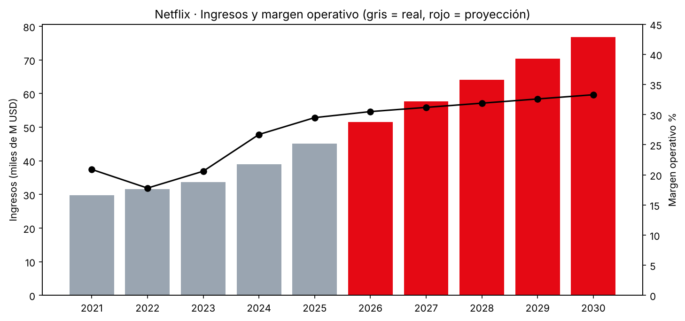

# 02 · Modelo de proyección PyG — Netflix (NFLX) 2026–2030

Proyección a 5 años de la cuenta de resultados de Netflix a partir de sus datos reales 2021–2025. Cifras en millones de USD.

## Flujo de trabajo

1. **Captura → datos:** la cuenta de resultados (fuente TIKR) se transcribió con IA a `netflix_pyg.csv`.
2. **Validación de cuadres:** antes de modelizar se comprueba que todos los subtotales (beneficio bruto, gastos operativos, EBIT, EBT, beneficio neto) cuadran con sus partidas. ✅ Diferencias máximas de ±0,01 (redondeo).
3. **Ratios históricos:** crecimiento, márgenes, peso de cada gasto sobre ingresos y tipo impositivo efectivo.
4. **Hipótesis:** un único bloque editable (una fila por driver, una columna por año).
5. **Proyección y salida:** PyG completa real + proyectada, márgenes, gráfico y exportación a Excel (4 pestañas).

## Escenario base (ilustrativo)

| Driver | 2026 → 2030 | Referencia histórica |
|---|---|---|
| Crecimiento de ingresos | 14 % → 9 % | 2025: +15,9 % |
| Coste de ventas / ingresos | 50,5 % → 48,5 % | 2025: 51,5 % |
| SG&A / ingresos | 11,5 % → 10,7 % | 2025: 11,5 % |
| I+D / ingresos | 7,5 % | 2025: 7,5 % |
| Tipo impositivo | 14 % | 2025: 13,7 % |

**Resultado:** ingresos de ~45.200 M$ (2025) a ~76.800 M$ (2030), con un margen operativo del 29,5 % al 33,3 %.

## Decisiones de modelización

- **Año base 2025** (último ejercicio cerrado) en lugar de LTM, porque el LTM mezcla trimestres de dos ejercicios.
- **Se excluyen los +2.800 M$ de partidas inusuales del LTM**, al tratarse de un extraordinario no recurrente.

## Cómo ejecutarlo

Pulsa el botón **Abrir en Colab** y ejecuta las celdas en orden (los datos se cargan solos desde este repositorio). Para probar otros escenarios, modifica solo la **Celda 3 (Hipótesis)**.

---
⚠️ *Escenario ilustrativo con fines formativos. No constituye recomendación de inversión.*
