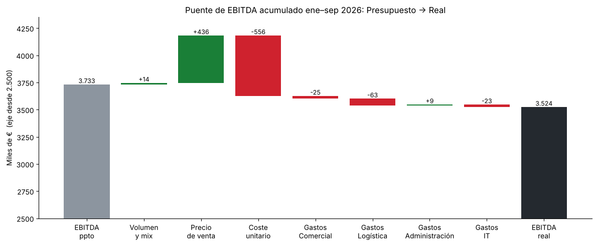

# Finanzas con IA · Automatización y análisis para control de gestión

Portfolio de proyectos prácticos en los que aplico **Python e inteligencia artificial** a tareas reales de un economista / controller financiero: descarga y tratamiento de datos, modelización financiera, generación automática de informes y análisis de márgenes.

> 🤖 **Cómo trabajo:** diseño el análisis desde el criterio financiero (qué calcular, qué hipótesis usar, cómo validar), utilizo **Claude (Anthropic)** como asistente de programación para escribir el código, y lo ejecuto, reviso y ajusto en **Google Colab**. El objetivo es demostrar que un perfil de finanzas puede construir herramientas de análisis reproducibles sin depender de un equipo técnico.

---

## 📂 Proyectos

| # | Proyecto | Qué demuestra | Herramientas |
|---|---|---|---|
| 01 | [Rentabilidad y volatilidad de acciones](01-rentabilidades-acciones/)  | Descarga de datos de mercado, cálculo de rentabilidades y generación automática de un informe en Excel + gráfico. Mismo análisis en **Notebook** (exploración) y en **Script** (automatización). | Python · pandas · yfinance · matplotlib |
| 02 | [Modelo de proyección PyG — Netflix 2026–2030](02-modelo-pyg-netflix/)  | Transcripción de estados financieros, **validación de cuadres**, ratios históricos y proyección a 5 años con hipótesis separadas del cálculo. | Python · pandas · matplotlib · Excel |
| 03 | [Análisis de desviaciones Real vs Presupuesto](03-desviaciones-real-vs-presupuesto/)  | Cierre mensual de una distribuidora (ficticia): PyG real vs presupuesto, **efecto precio/volumen/mix**, alertas por materialidad, mapa de calor de gastos, **puente de EBITDA** y conclusiones de negocio. | Python · pandas · matplotlib · Excel |

---

## 🛠️ Cómo ejecutar los proyectos

No hace falta instalar nada:

1. Abre [Google Colab](https://colab.research.google.com).
2. **Archivo → Abrir cuaderno → GitHub** y pega la URL de este repositorio.
3. Si el notebook usa un fichero de datos (`.csv`), súbelo al panel de archivos 📁.
4. Ejecuta las celdas en orden con **Shift + Enter**.

Para ejecutarlo en local: `pip install -r requirements.txt`.

---

## 🧭 Principios que sigo

- **Validar antes de modelizar:** cada conjunto de datos pasa una comprobación de cuadre (subtotales, sumas) antes de usarse.
- **Hipótesis separadas del cálculo:** las hipótesis están en un único bloque editable; el resto del modelo se recalcula en cascada.
- **Resultados reproducibles:** los scripts guardan sus salidas (Excel, imágenes) en carpetas con fecha.

---

⚠️ *Proyectos con fines formativos y de demostración. Las proyecciones son escenarios ilustrativos y no constituyen recomendación de inversión. Datos financieros de fuentes públicas (Yahoo Finance; estados financieros publicados por las compañías, vía TIKR).*
